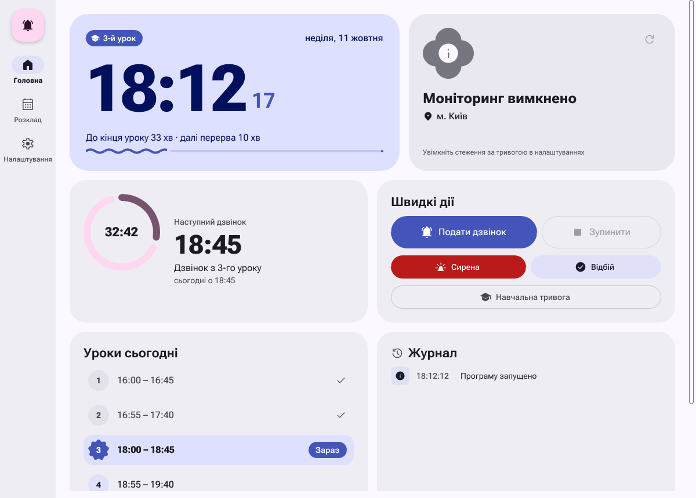
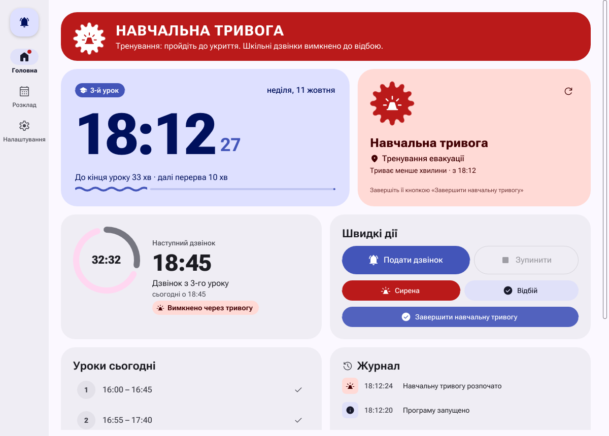
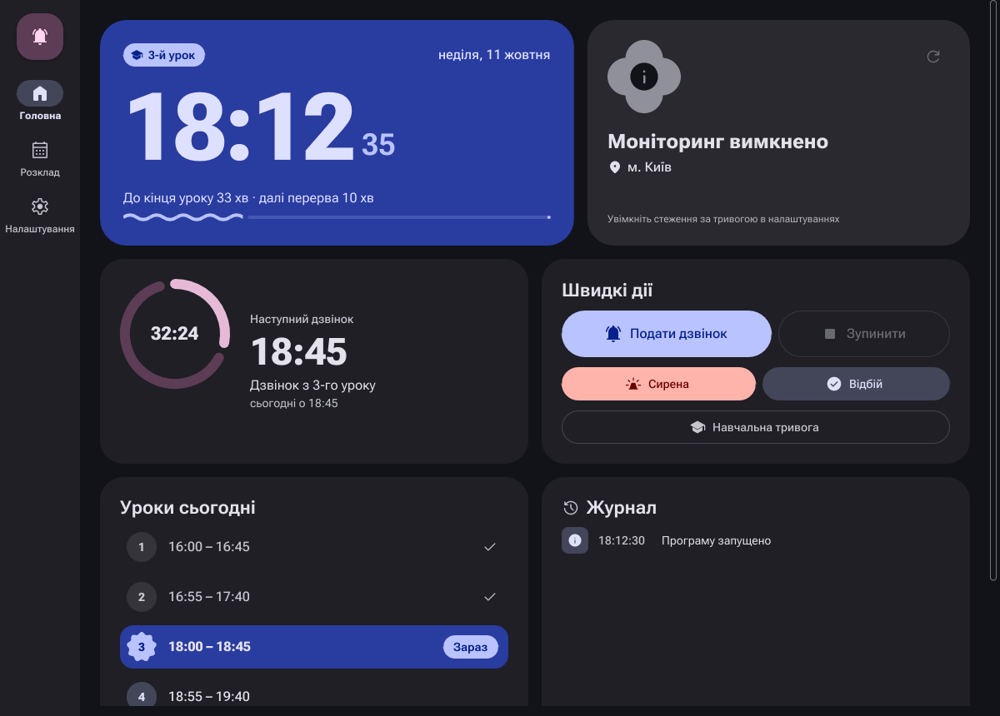
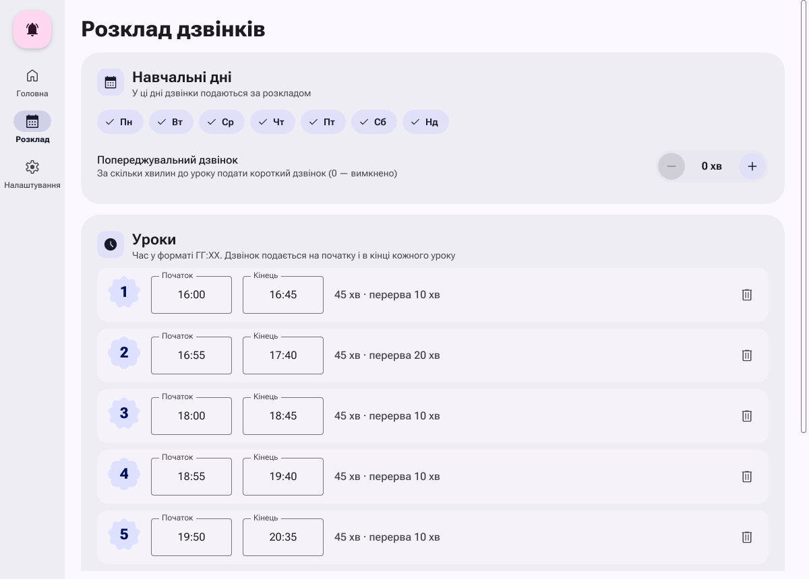
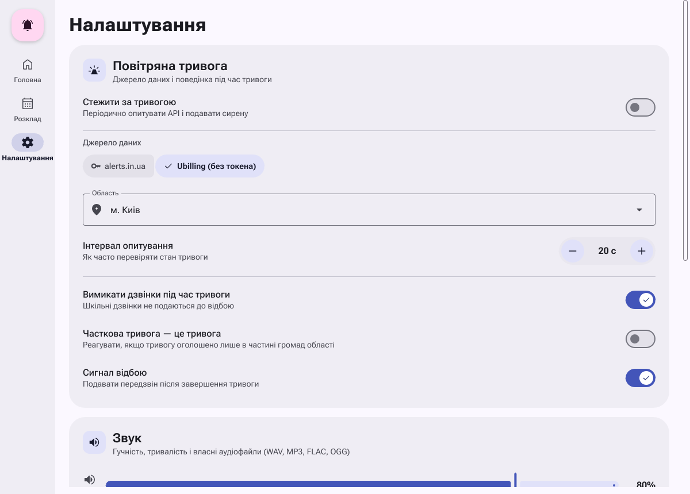

# Шкільні дзвінки

Настільна програма, яка подає шкільні дзвінки за розкладом і стежить за
повітряною тривогою: на початку тривоги вмикає сирену, на відбої — сигнал
відбою, а поки тривога триває, за бажанням не подає звичайних дзвінків.

Написана на **Rust**, інтерфейс — **Slint** у стилі
**Material Design 3 Expressive**. Працює на Linux, Windows і macOS.



| Навчальна тривога | Темна тема |
| --- | --- |
|  |  |

| Розклад | Налаштування |
| --- | --- |
|  |  |

## Можливості

- **Дзвінки за розкладом** — на початку і в кінці кожного уроку, у вибрані
  дні тижня; опційно — попереджувальний дзвінок за кілька хвилин до уроку.
- **Повітряна тривога** — програма періодично опитує API і показує стан
  тривоги у вибраній області:
  - на початку тривоги звучить сирена і з'являється червоний банер
    «ПОВІТРЯНА ТРИВОГА»;
  - під час тривоги шкільні дзвінки не подаються (вимикається в налаштуваннях);
  - після відбою звучить спокійний передзвін;
  - збій мережі не вважається відбоєм.
- **Навчальна тривога** — кнопка для тренування евакуації: сирена, банер,
  вимкнені дзвінки, а після завершення — сигнал відбою.
- **Вбудовані звуки без файлів** — електромеханічний шкільний дзвоник,
  механічна сирена (розкручування, завивання, зупинка) і передзвін відбою
  синтезуються програмно. За бажанням їх можна замінити своїми файлами
  WAV, MP3, FLAC або OGG.
- **Головна сторінка** — великий годинник, поточний урок чи перерва з
  прогресом, відлік до наступного дзвінка, швидкі дії, уроки на сьогодні та
  журнал подій.
- **Редактор розкладу** з перевіркою: неправильний час, перетин уроків або
  кінець раніше початку підсвічуються одразу.
- **Світла, темна або системна тема**, адаптивне компонування для вузьких
  вікон.
- Якщо комп'ютер «прокинувся» після сну, пропущені дзвінки не подаються
  заднім числом.

## Джерела даних про тривогу

| Джерело | Токен | Що повертає |
| --- | --- | --- |
| [Ubilling](https://ubilling.net.ua/aerialalerts/) (типове) | не потрібен | тривога в області є / немає |
| [alerts.in.ua](https://alerts.in.ua) | потрібен, отримати на [devs.alerts.in.ua](https://devs.alerts.in.ua) | тривога в усій області / у частині громад / немає |

Для alerts.in.ua використовується легкий IoT-ендпоінт
`/v1/iot/active_air_raid_alerts/{uid}.json`. Тривога в частині громад
області за замовчуванням лише показується жовтим, а увімкнувши
«Часткова тривога — це тривога», можна реагувати на неї як на повну.

Інтервал опитування — від 10 секунд (типово 20). Не ставте його надто
малим: у публічних API є обмеження на кількість запитів.

## Встановлення

### Готові збірки

Кожен коміт збирається в GitHub Actions для Linux, Windows і macOS —
готові файли можна завантажити з артефактів відповідного запуску CI.

### Збірка з вихідного коду

Потрібен Rust **1.92** або новіший (<https://rustup.rs>).

Linux (Debian/Ubuntu) — системні бібліотеки для звуку і вікон:

```sh
sudo apt install libasound2-dev libxkbcommon-dev libfontconfig1-dev
```

Далі на будь-якій системі:

```sh
git clone https://github.com/pachdomenic/Pererva.git
cd Pererva
cargo build --release
./target/release/shkilni-dzvinky
```

### Ярлик і автозапуск у Linux

```sh
install -Dm755 target/release/shkilni-dzvinky ~/.local/bin/shkilni-dzvinky
install -Dm644 packaging/shkilni-dzvinky.desktop ~/.local/share/applications/shkilni-dzvinky.desktop
install -Dm644 packaging/shkilni-dzvinky.svg ~/.local/share/icons/hicolor/scalable/apps/shkilni-dzvinky.svg
# автозапуск після входу в систему:
install -Dm644 packaging/shkilni-dzvinky.desktop ~/.config/autostart/shkilni-dzvinky.desktop
```

У Windows для автозапуску покладіть ярлик на `shkilni-dzvinky.exe` у теку,
що відкривається командою `shell:startup`.

## Використання

```text
shkilni-dzvinky [ПАРАМЕТРИ]

  -c, --config <ФАЙЛ>  шлях до файлу налаштувань
  -h, --help           показати довідку
  -V, --version        показати версію
```

Комп'ютер із програмою має бути підключений до системи оповіщення
(підсилювача і гучномовців) школи — програма відтворює звук через типовий
аудіопристрій системи.

Усе налаштовується в інтерфейсі; зміни розкладу і налаштувань зберігаються
кнопкою «Зберегти» на панелі, що з'являється внизу, а тема — одразу.

## Файл налаштувань

Програма зберігає налаштування у TOML-файлі:

| Система | Шлях |
| --- | --- |
| Linux | `~/.config/shkilni-dzvinky/config.toml` |
| Windows | `%APPDATA%\shkilni-dzvinky\config.toml` |
| macOS | `~/Library/Application Support/shkilni-dzvinky/config.toml` |

Приклад з поясненнями всіх параметрів — у
[`config.example.toml`](config.example.toml). Будь-яке поле можна
пропустити — буде використано типове значення.

<details>
<summary>Ідентифікатори областей (<code>region_uid</code>)</summary>

| uid | Область | uid | Область |
| --- | --- | --- | --- |
| 29 | Автономна Республіка Крим | 18 | Одеська область |
| 4 | Вінницька область | 19 | Полтавська область |
| 8 | Волинська область | 5 | Рівненська область |
| 9 | Дніпропетровська область | 20 | Сумська область |
| 28 | Донецька область | 21 | Тернопільська область |
| 10 | Житомирська область | 22 | Харківська область |
| 11 | Закарпатська область | 23 | Херсонська область |
| 12 | Запорізька область | 3 | Хмельницька область |
| 13 | Івано-Франківська область | 24 | Черкаська область |
| 14 | Київська область | 26 | Чернівецька область |
| 15 | Кіровоградська область | 25 | Чернігівська область |
| 16 | Луганська область | 31 | м. Київ |
| 27 | Львівська область | 30 | м. Севастополь |
| 17 | Миколаївська область |  |  |

</details>

## Дизайн

Інтерфейс побудовано на власних компонентах Material 3 Expressive,
написаних на Slint (`ui/components`):

- кнопки, що пружинно змінюють форму при натисканні, з'єднані групи кнопок,
  Extended FAB;
- Expressive-слайдер із товстою доріжкою і вертикальною ручкою, перемикачі,
  поля з плаваючим підписом, чіпи, степпери, випадаючий список;
- хвилястий лінійний і кільцевий індикатори прогресу;
- форми з бібліотеки Expressive (печиво, вибух, квітка, чотирилисник) з
  морфінгом між станами: печиво — тривоги немає, квітка — часткова тривога,
  вибух, що обертається і пульсує, — тривога;
- шрифт Roboto Flex зі змінною вагою, колірні схеми з розширеними ролями
  для тривоги і відбою, пружинні криві руху.

## Структура проєкту

```text
src/
  main.rs            розбір параметрів і запуск
  schedule.rs        модель розкладу, події дзвінків, стан дня
  config.rs          налаштування у TOML
  alert/             джерела тривоги, фоновий монітор, відстеження тривоги
  audio/             синтез звуків і програвач
  app/               контролер, чернетка розкладу, форматування українською
ui/
  app-window.slint   головне вікно і навігація
  theme.slint        токени дизайн-системи
  state.slint        глобальний стан інтерфейсу
  components/        компоненти Material 3 Expressive
  pages/             сторінки: головна, розклад, налаштування
  fonts/ icons/ shapes/
tools/gen_shapes.py  генератор SVG-форм
packaging/           ярлик .desktop та іконка
```

## Розробка

```sh
cargo test                                  # юніт-тести
cargo clippy --all-targets -- -D warnings   # лінтер
cargo fmt                                   # форматування
python3 tools/gen_shapes.py                 # перегенерувати форми
```

Як зменшено шрифт — див. [`ui/fonts/README.md`](ui/fonts/README.md).

## Ліцензія

Програма поширюється за ліцензією
[GNU GPL версії 3 або новішої](LICENSE).

Сторонні ресурси:

- шрифт [Roboto Flex](https://github.com/googlefonts/roboto-flex) —
  SIL Open Font License 1.1;
- іконки [Material Symbols](https://fonts.google.com/icons) — Apache 2.0;
- [Slint](https://slint.dev) використовується на умовах GPLv3.
